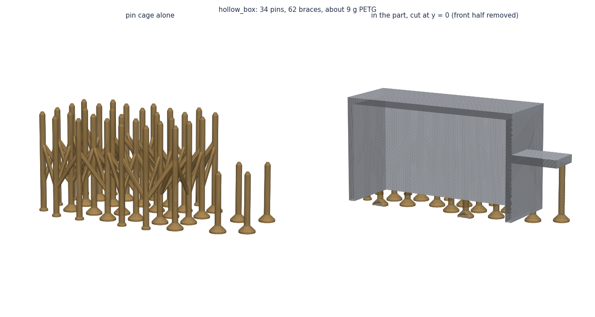
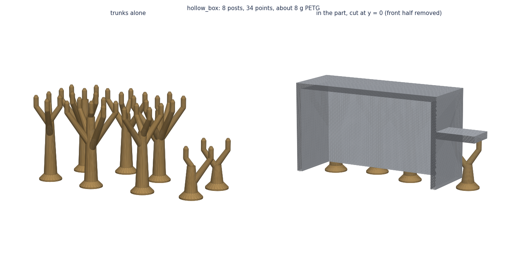

# claude-print-supports

Your own 3D-print supports, generated from the STL instead of left to the slicer. Two Python tools, written with
Claude for the parts of a robot owl, made general:

- **`pin_support.py`**: a cage of thin "thumbtack" pins from the bed, braced together. Each pin stops one layer
  (0.2 mm) under the ceiling it holds, so the ceiling's first layer sits on the points and the whole cage pops off
  in one piece. On our biggest shell it used 47 g of support where the slicer's tuned organic support used 86 g.
- **`trunk_support.py`**: the same points, but neighbouring pins share one post that branches out to them. Far
  fewer separate islands per layer, so it prints faster than the pin cage. Use it where the slicer's own support
  is heavy (a big hidden ceiling).




## How the pins are placed

1. **Find what needs support.** Rays go up from the bed every half millimetre. Where the first surface a ray
   meets faces down flatter than 40° (PrusaSlicer's default overhang threshold), that spot needs support. As with
   "support on build plate only", ceilings over the part itself get none, and specks of surface texture are left.
2. **Place pins.** Flattest spots first, a pin goes wherever a spot is more than 10 mm from every pin so far. Each
   column is checked to stay 0.6 mm clear of the part all the way up.
3. **Shape each pin.** A 6 mm foot on the bed, a 2.2 mm column, then a 30° cone to a 1 mm point that stops 0.2 mm
   (one layer) under the ceiling, like the slicer's top contact distance.
4. **Brace them** (pins) or **group them on trunks** (trunks). Braces climb at 55° from one pin to its neighbour,
   steeper than an overhang, so they print without bridging. Trunk branches climb at 55° too.
5. **Export.** You get the support alone in the part's own frame, and the part and support merged into one STL.
   Slice the merged one with the slicer's supports **off**.

## Use

Export your part as an STL already in its print orientation: bed at z = 0, up = +z.

```bash
pip install -r requirements.txt
python pin_support.py my_part.stl            # or: python trunk_support.py my_part.stl
python render_pin_support.py my_part.stl     # optional pictures: plan and cage
```

This writes, next to the part, `my_part_pins.stl` (support only) and `my_part_with_pins.stl` (part + support,
slice with supports off), and a folder `my_part_pin_support/` with `build_info.json`: number of pins, grams of
support (PETG), the smallest gap to the part, whether the output is watertight.

Options worth knowing (see `python pin_support.py -h` for all of them):

- `--keep-out X0 Y0 X1 Y1` (repeatable): a box in the print frame where no pin may stand, e.g. under a nut slot
  whose roof should bridge on its own.
- `--spacing 10`: mm between pins. Smaller holds a soft ceiling better, larger saves material.
- `--overhang 40`: degrees from horizontal; match your slicer's threshold.
- `--tip-gap 0.2`: set it to your layer height.
- `trunk_support.py --reach 14`: how far a trunk reaches out to its pins.

Try it on the example: `python examples/make_example.py` writes `examples/hollow_box.stl`, a box standing open side
down with a shelf on one side.

## Good to know

- Pins pay off on big hidden ceilings (shells, enclosures), where tree supports grow a tangle that is hard to get
  out. On a part where the slicer's support is already light, they can cost more than they save.
- The pin cage is slower to print than its weight suggests: every pin and brace is its own little island on every
  layer. That is what the trunks fix.
- The part must be watertight for the clearance check (`trunk_support.py` refuses otherwise; `pin_support.py`
  then skips the boolean and just places the pins next to it).
- Estimates only: always look at the result in your slicer's preview before printing.

## License

MIT, see [LICENSE](LICENSE). Made by [Hosgungor Industries](https://www.tiktok.com/@hosgungor.industr).
