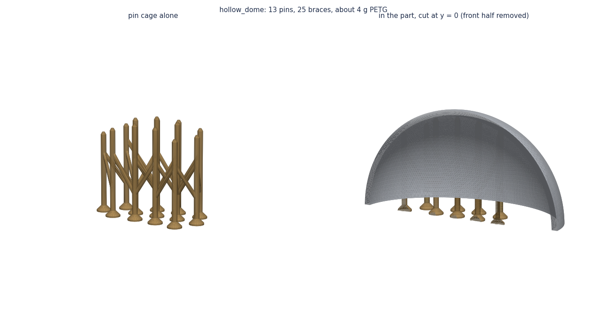
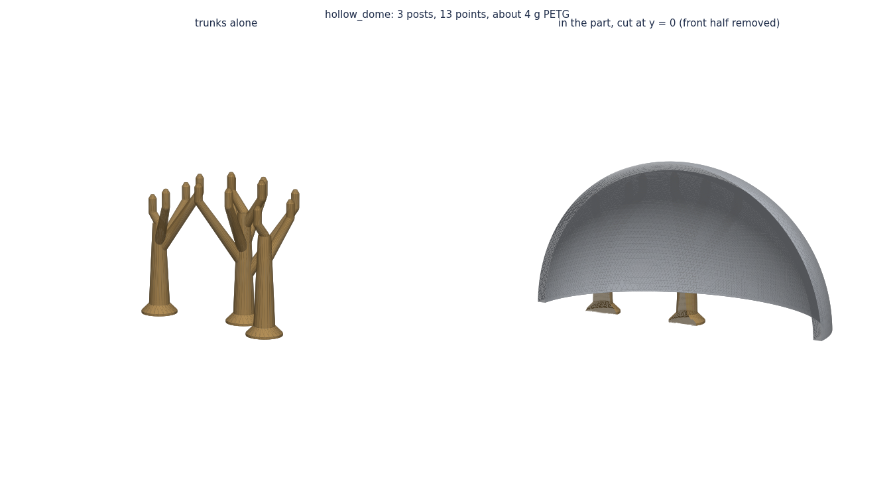

# claude-print-supports

Your own 3D-print supports, generated from the STL instead of left to the slicer. Two Python tools, written with
Claude for the printed parts of our own product, made general:

- **`pin_support.py`**: a cage of thin "thumbtack" pins from the bed, braced together. Each pin stops one layer
  (0.2 mm) under the ceiling it holds, so the ceiling's first layer sits on the points and the whole cage pops off
  in one piece.
- **`trunk_support.py`**: the same points, but neighbouring pins share one post that branches out to them. Far
  fewer separate islands per layer, so it prints faster than the pin cage.

Neither beats the slicer everywhere: see [the comparison](#how-they-compare) and
[where they don't help](#where-they-dont-help) before you use them.




## How the pins are placed

1. **Find what needs support.** Rays go up from the bed every half millimetre. Where the first surface a ray
   meets faces down flatter than 40° (PrusaSlicer's default overhang threshold), that spot needs support. As with
   "support on build plate only", ceilings over the part itself get none, and specks of surface texture are left.
2. **Place pins.** Flattest spots first, a pin goes wherever a spot is more than 10 mm from every pin so far. Each
   column is checked to stay 0.6 mm clear of the part all the way up.
3. **Shape each pin.** A 6 mm foot on the bed, a 2.2 mm column, then a 30° cone to a 1 mm point that stops 0.2 mm
   (one layer) under the ceiling, like the slicer's top contact distance.
4. **Brace them** (pins) or **group them on trunks** (trunks). Braces climb at 55° from one pin to its neighbour,
   steeper than an overhang, so they print without bridging. Trunk branches climb at 55° too.
5. **Export.** You get the support alone in the part's own frame, and the part and support merged into one STL.
   Slice the merged one with the slicer's supports **off**.

## Use

Export your part as an STL already in its print orientation: bed at z = 0, up = +z.

```bash
pip install -r requirements.txt
python pin_support.py my_part.stl            # or: python trunk_support.py my_part.stl
python render_pin_support.py my_part.stl     # optional pictures: plan and cage
```

This writes, next to the part, `my_part_pins.stl` (support only) and `my_part_with_pins.stl` (part + support,
slice with supports off), and a folder `my_part_pin_support/` with `build_info.json`: number of pins, grams of
support (PETG), the smallest gap to the part, whether the output is watertight.

Options worth knowing (see `python pin_support.py -h` for all of them):

- `--keep-out X0 Y0 X1 Y1` (repeatable): a box in the print frame where no pin may stand, e.g. under a nut slot
  whose roof should bridge on its own.
- `--spacing 10`: mm between pins. Smaller holds a soft ceiling better, larger saves material and time.
- `--overhang 40`: degrees from horizontal; match your slicer's threshold.
- `--tip-gap 0.2`: set it to your layer height.
- `trunk_support.py --reach 14`: how far a trunk reaches out to its pins.

The example parts: `python examples/make_dome.py` writes `examples/hollow_dome.stl` (a hollow dome standing open
side down, like a printed shell) and `python examples/make_example.py` writes `examples/hollow_box.stl` (a box
standing open side down, with a shelf on one side).

## How they compare

Every row was sliced in PrusaSlicer 2.9.6 for a Prusa MK4S (0.4 mm HF nozzle), Generic PETG, 0.20 mm STRUCTURAL,
3 perimeters, 15 % infill, slicer supports on the build plate only. Slicer organic uses our tuned settings
(threshold 35°, 2 mm branches, 0.8 mm tips, 0.25 mm contact distance). "Support" is the filament on top of the
part alone. Estimates from the slicer, not weighed prints.

**A big printed shell** (one of our own parts, about 215 g; its ceiling is a large hidden curve):

| Support | Support filament | Whole print |
|---|---:|---:|
| Slicer organic, tuned | 87 g | 23 h 31 m |
| Slicer snug | 232 g | 24 h 06 m |
| Pins, spacing 10 | **47 g** | 25 h 27 m |
| Trunks | **41 g** | **20 h 18 m** |

This is the case they were made for: trunks use less than half the slicer's filament and save 3 hours. The pins
use as little but take 2 hours longer, and the cage came off in one piece.

**`hollow_dome.stl`** (90 x 70 x 44 mm, 2.4 mm wall, 30 g without support):

| Support | Support filament | Whole print |
|---|---:|---:|
| None (the flat top would sag) | 0 g | 1 h 21 m |
| Slicer organic, tuned | 3.7 g | 1 h 48 m |
| Slicer snug | 9.9 g | 1 h 39 m |
| Slicer grid | 11.8 g | 1 h 43 m |
| Pins, spacing 8 | 6.6 g | 2 h 38 m |
| Pins, spacing 10 (default) | 3.4 g | 2 h 03 m |
| Pins, spacing 14 (no braces: 8 loose pins) | 1.6 g | 1 h 41 m |
| Trunks | 3.0 g | 1 h 43 m |

A small shell is close to a draw: tuned organic is already light, the trunks match it on time with a little less
filament, and the default pin cage costs 15 extra minutes. Snug and grid supports use three times as much.

**`hollow_box.stl`** (70 x 50 x 40 mm with an 18 mm shelf, 36 g without support):

| Support | Support filament | Whole print |
|---|---:|---:|
| None | 0 g | 1 h 33 m |
| Slicer organic, tuned | 0.5 g | 1 h 38 m |
| Slicer snug | 0.8 g | 1 h 36 m |
| Slicer grid | 1.6 g | 1 h 37 m |
| Pins, spacing 8 | 10.0 g | 3 h 33 m |
| Pins, spacing 10 (default) | 8.0 g | 3 h 12 m |
| Pins, spacing 14 | 2.7 g | 2 h 08 m |
| Trunks | 7.2 g | 2 h 27 m |

Here the tools lose badly: see below.

## Where they don't help

- **Flat ceilings the slicer can bridge.** The box's roof is flat and walled in on all four sides, so the slicer
  prints it as a bridge with almost no support (0.5 g). The tools don't know about bridging: they hold every flat
  spot, and add 8 g and an extra 1.5 hours.
- **Parts whose slicer support is already light.** On the small dome, tuned organic uses under 4 g. The best the
  tools can do there is match it. They pay off when the slicer's support runs to tens of grams (the big shell).
- **When print time matters more than filament.** Every pin and brace is a separate little island on every layer:
  a stop, a retract and a slow loop each time. The pin cage is the slowest option in every table above. Use the
  trunks, or a wider `--spacing`, if time counts.
- **Overhangs over the part itself.** Like "support on build plate only", nothing stands on the part, so an
  overhang above another surface of the part gets no support.
- **Ceilings with fine detail.** Each tip leaves a small dot where it touched. On a visible textured ceiling, the
  slicer's interface layers may leave a cleaner surface.
- **Steep overhangs and short ones.** Faces steeper than `--overhang` and overhangs lower than 4 mm get nothing:
  they print as they are, as they would with the slicer.
- **Meshes with errors.** `trunk_support.py` needs a watertight part for its clearance check and refuses others.
  `pin_support.py` still places pins but can't prove they stay clear of the part.

Always check the result in your slicer's preview before printing.

## License

MIT, see [LICENSE](LICENSE). Made by [Hosgungor Industries](https://www.tiktok.com/@hosgungor.industr).
